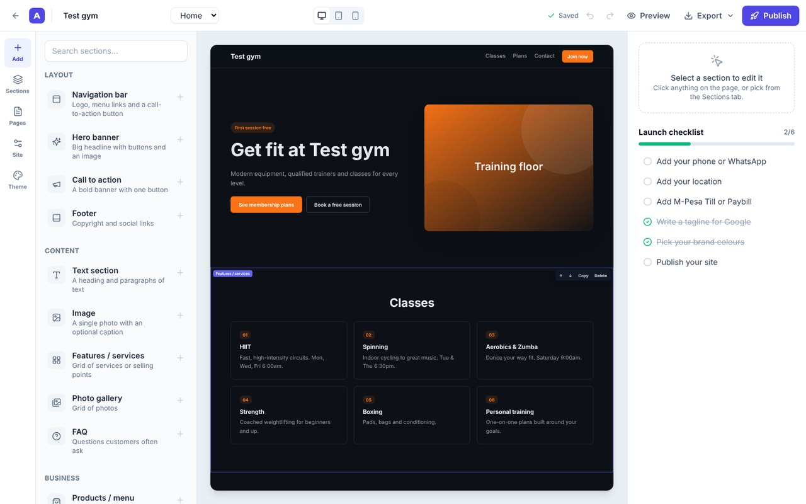
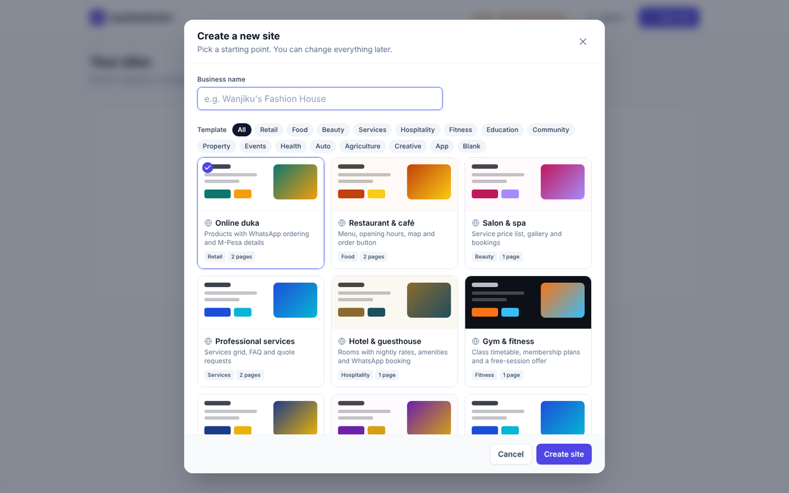
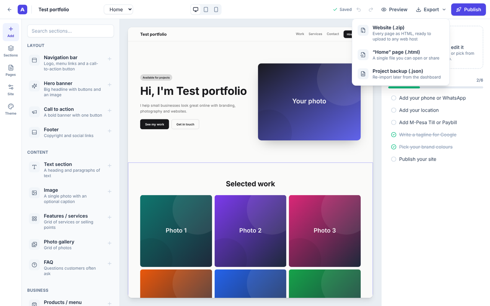
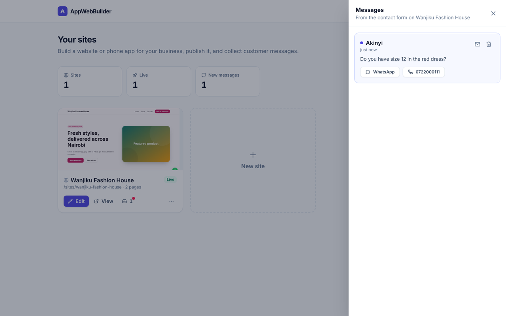
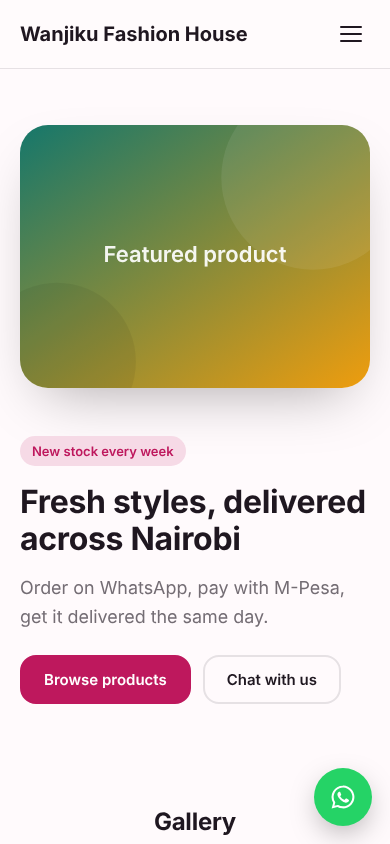

# AppWebBuilder

A no-code website and phone-app builder for Kenyan small businesses.

Owners pick a template, click on the page to edit it, add their WhatsApp number and M-Pesa till, and publish. Customers can see prices, order on WhatsApp, pay with M-Pesa and send messages that land in the owner's dashboard inbox.



## Contents

- [Features](#features)
- [Screenshots](#screenshots)
- [Getting started](#getting-started)
- [Scripts](#scripts)
- [How it works](#how-it-works)
- [Project structure](#project-structure)
- [API](#api)
- [Configuration](#configuration)
- [Roadmap](#roadmap)

## Features

### Built for how Kenyans buy

- **WhatsApp ordering.** Every product has a button (Order, Book, Enquire or Join) that opens WhatsApp with the item and price already typed, for example *"Hi Mama Njeri Kitchen, I'd like to order: Beef pilau (KES 450)"*.
- **M-Pesa details.** Show a Till (Buy Goods) or Paybill number on the contact section.
- **Local phone numbers.** Numbers like `0712 345 678` are converted to `254712345678` for WhatsApp and call links.
- **Floating WhatsApp button** on every page, plus opening hours, price lists and a map of your location.

### Templates

16 templates, filterable by category, each with its own colour theme and sample prices in KES:

| | | | |
|---|---|---|---|
| Online duka | Restaurant & café | Salon & spa | Professional services |
| Hotel & guesthouse | Gym & fitness | School & tuition | Church & community |
| Property & rentals | Events & catering | Clinic & pharmacy | Garage & car hire |
| Farm produce | Freelancer portfolio | Mobile shop app | Start from scratch |

### Builder

- 14 section types: navigation, hero, text, image, features, products/menu, gallery, reviews, opening hours, FAQ, call to action, contact & payment, footer and a phone-app tab bar
- Click any section on the canvas to edit its text, images, links and lists
- Drag sections to reorder them, or use the toolbar that appears on hover
- Multiple pages, with links between pages and to sections on a page
- 13 theme presets, custom brand colours, Google Fonts and corner roundness
- Desktop, tablet and phone previews, and a Preview mode where buttons and forms work
- Undo and redo, autosave, and keyboard shortcuts (Ctrl+Z, Ctrl+Shift+Z, Ctrl+S, Delete)
- Image upload with in-browser resizing
- A launch checklist for phone, location, M-Pesa, tagline, colours and publishing

### Publishing and export

- One-click publish to `/sites/<your-address>/`, with a share-on-WhatsApp link
- Every published site is an installable web app (manifest, icon and an offline-capable service worker), so customers can add it to their home screen
- Contact form with spam protection (honeypot field and per-IP rate limiting); messages go to the dashboard inbox
- Export the whole site as a `.zip` of HTML files, the current page as one `.html` file, or a project backup (`.json`) that can be imported again from the dashboard
- On an exported site with no server behind it, the contact form sends the message through WhatsApp instead

## Screenshots

| Choosing a template | Exporting a site |
|---|---|
|  |  |

| Messages inbox | A published site on a phone |
|---|---|
|  |  |

## Getting started

You need [Node.js](https://nodejs.org) 20 or newer.

```bash
git clone https://github.com/NgachaIan/AppWebBuilder.git
cd AppWebBuilder
npm install
npm run dev
```

Open http://localhost:5173. The API runs on port 4000, and Vite forwards `/api` and `/sites` requests to it.

To run everything as a single production server:

```bash
npm run build
npm start
```

The builder and the published sites are then served from http://localhost:4000.

### Browser-only demo

```bash
npm run build:demo
```

This writes one self-contained file, `client/dist-demo/index.html`. Open it in any browser: it runs without a server and keeps sites in the browser's local storage. Messages sent from the contact form in Preview mode go to the dashboard inbox.

### Marketing page

`marketing/landing.html` is a standalone landing page that advertises AppWebBuilder to small businesses. It needs no build step. Open it in a browser or upload it to any web host.

## Scripts

| Command | What it does |
|---|---|
| `npm run dev` | Starts the API (with auto-reload) and the Vite dev server together |
| `npm run build` | Builds the builder app into `client/dist` |
| `npm start` | Runs the API and serves `client/dist` and published sites on one port |
| `npm run build:demo` | Builds the single-file browser-only demo into `client/dist-demo` |
| `npm run typecheck` | Type-checks the client, server and shared code |

## How it works

A project is plain JSON: a theme, business details (name, WhatsApp, M-Pesa), and pages made of blocks. Each block has a type and a set of props.

One renderer, `shared/render.ts`, turns a project into HTML and CSS. It is used in three places:

1. **The editor canvas.** An iframe receives the rendered page through `postMessage` on every edit, so it updates without reloading and keeps its scroll position.
2. **Published sites.** The server renders pages on request at `/sites/<slug>/`.
3. **Exports.** The browser renders static HTML files and zips them.

Because all three share the same renderer, what you see while editing is what customers get.

The inspector is generated from block definitions in `shared/blocks.ts`. Each block lists its fields (text, textarea, image, link, toggle, select or list), so adding a new section type means adding one definition and one render function.

## Project structure

```
shared/              Code used by both the browser and the server
  types.ts             Project, Page, Block, Theme, Business, Lead
  blocks.ts            Section definitions: inspector fields and defaults
  templates.ts         Starter templates and theme presets
  render.ts            HTML/CSS renderer for the canvas, published sites and exports
server/              Express 5 API
  index.ts             REST API, published sites, PWA files, ZIP export, leads
  store.ts             JSON file store (server/data/db.json), written atomically
client/              React 19 + Vite + Tailwind CSS v4
  src/pages/           Dashboard, Builder
  src/components/      Canvas, panels, inspector, field editors, export menu, modals
  src/lib/             API client, browser-only API for the demo, exporter, undo history
marketing/           Standalone landing page
docs/screenshots/    Images used in this README
```

## API

| Method | Path | Purpose |
|---|---|---|
| GET | `/api/templates` | List templates |
| GET | `/api/projects` | List sites |
| POST | `/api/projects` | Create a site from a template: `{ name, template }` |
| POST | `/api/projects/import` | Create a site from a backup |
| GET, PUT, DELETE | `/api/projects/:id` | Read, save or delete a site |
| POST | `/api/projects/:id/duplicate` | Copy a site |
| POST | `/api/projects/:id/publish` | Publish or unpublish: `{ published: true \| false }` |
| GET | `/api/projects/:id/preview?page=` | Rendered HTML for one page |
| GET | `/api/projects/:id/export` | Download the site as a ZIP |
| GET | `/api/projects/:id/leads` | List contact-form messages |
| PATCH, DELETE | `/api/projects/:id/leads/:leadId` | Mark a message read or unread, or delete it |
| POST | `/api/sites/:slug/leads` | Public contact-form endpoint (CORS enabled) |
| GET | `/sites/:slug/:page?` | A published page |

## Configuration

| Variable | Default | Purpose |
|---|---|---|
| `PORT` | `4000` | Port for the API and production server |
| `DATA_DIR` | `server/data` | Folder where `db.json` is stored |

## Roadmap

This version is single-user with no login. To run it as a multi-customer SaaS, the main pieces still to build are:

- [ ] **Accounts:** sign-up and login, with projects and messages scoped to each user or business
- [ ] **Database and storage:** Postgres instead of `db.json`, and uploaded images in object storage instead of inside the project
- [ ] **Plans and billing:** free and paid tiers with limits on sites, pages and branding, paid by M-Pesa (Daraja STK Push) or card
- [ ] **Custom domains:** connect a domain such as `yourshop.co.ke` to a site, with automatic HTTPS
- [ ] **Payments on sites:** a "Pay now" button that sends an M-Pesa STK Push to the customer's phone
- [ ] **Notifications:** new messages by SMS, email or WhatsApp
- [ ] **SEO and analytics:** sitemap, per-page meta tags and visitor stats
